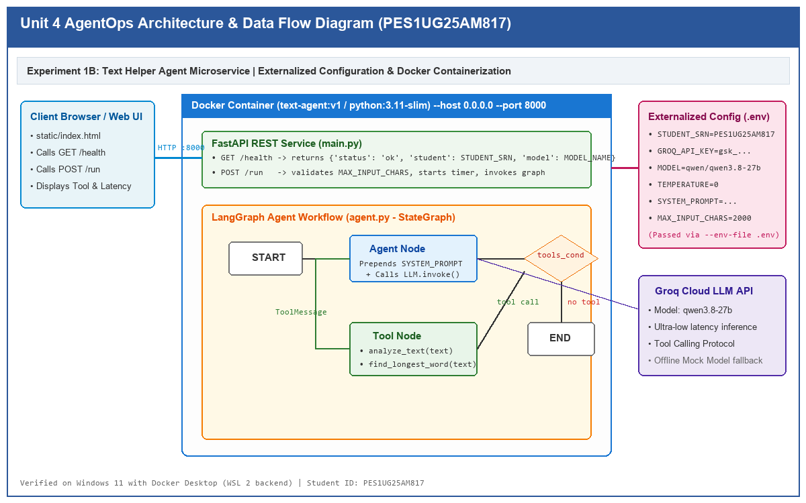
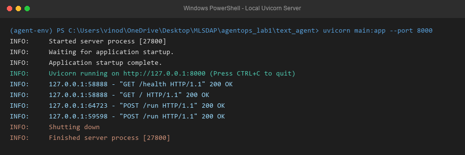
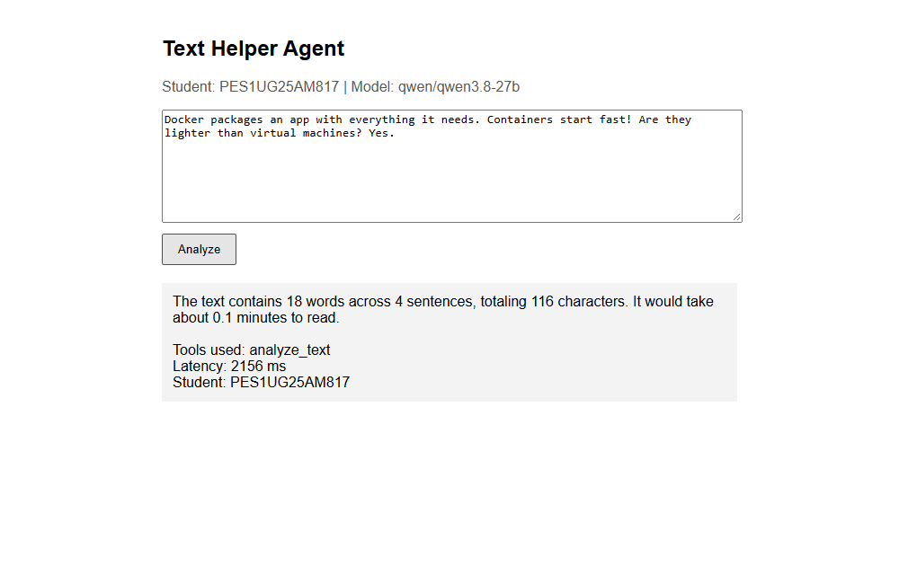
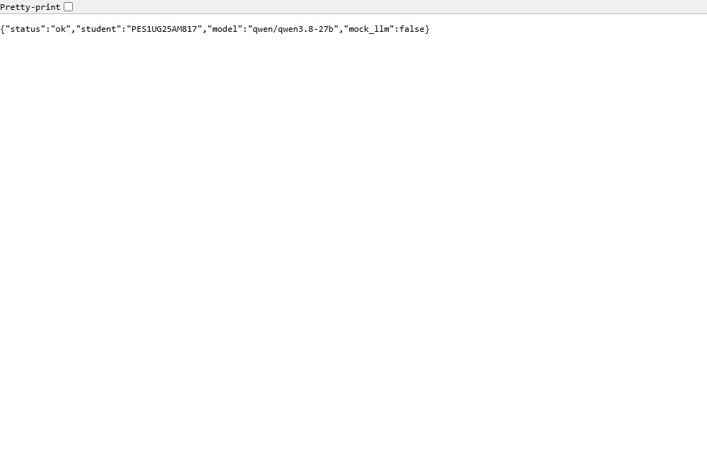
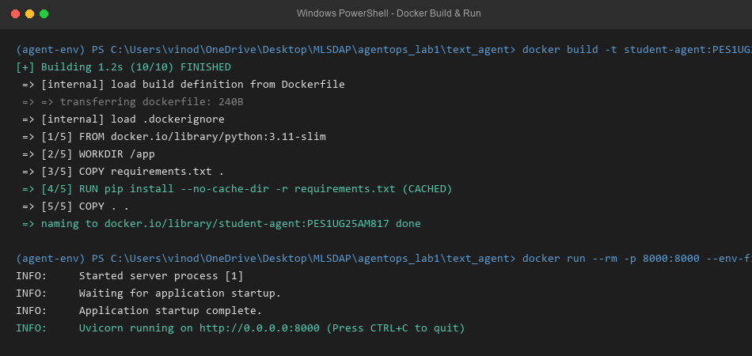
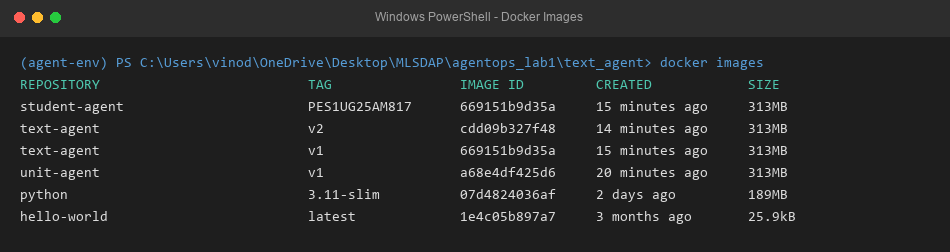
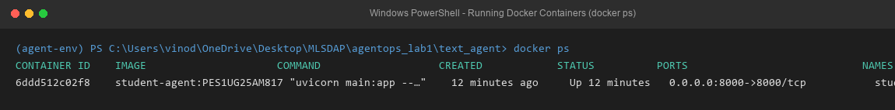
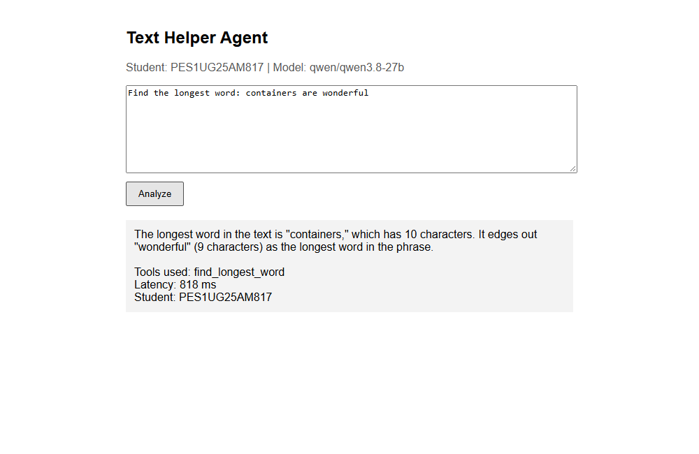
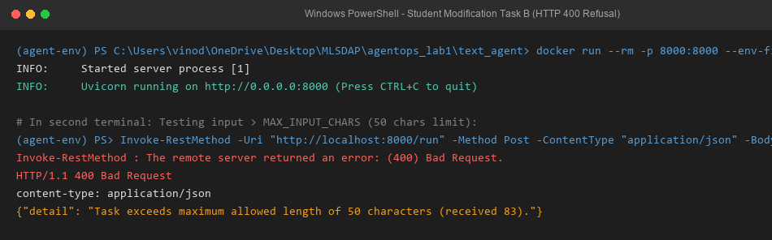

# ML System Design and AgentOps Lab Manual
## Unit 4 Hands-On Activity 1: Hosting, Consuming and Containerizing an AI Agent
**B.Tech CSE (AI & ML) — PES University**  
**Student Name:** Vinod  
**Student SRN:** `PES1UG25AM817`  
**Date:** November 19, 2026  

---

## 1. Objective & Scope

The objective of this hands-on laboratory is to:
1. Construct an AI agent utilizing **LangGraph** with a tool-calling loop.
2. Host the agent microservice via **FastAPI** exposing REST endpoints (`/health`, `/run`, and `/`).
3. Consume the agent from an interactive browser-based web application (`static/index.html`).
4. Package the application as an optimized **Docker** container image with layer-cached dependencies.
5. Implement **externalized configuration** using `.env` and `--env-file`, demonstrating secret management and zero-rebuild behavioral changes.
6. Verify student identification stamping via `STUDENT_SRN` across API responses and web interfaces.

---

## 2. Architecture & Data Flow Diagram

The complete system architecture diagram is saved as **`PES1UG25AM817_agent_flow.png`**.

### Key Architectural Layers:
* **Client Presentation Layer:** Browser interface (`static/index.html`) communicating over standard HTTP fetch requests.
* **REST API Layer:** FastAPI (`main.py`) routing requests, performing input validation (`MAX_INPUT_CHARS`), and measuring execution latency.
* **Orchestration Layer:** LangGraph StateGraph (`agent.py`) maintaining message state and driving the `agent_node` $\leftrightarrow$ `ToolNode` loop.
* **Tool Execution Layer:** Pure Python tools (`tools.py`) providing text analytics (`analyze_text`) and search (`find_longest_word`).
* **Model Inference Layer:** Cloud-hosted Groq LLM (`qwen/qwen3.8-27b`) with automatic fallback to `MockChatModel` for offline operation.
* **Containerization Boundary:** Docker container running on Linux via WSL 2, isolating environment dependencies while accepting configuration at startup via `--env-file`.

---

## 3. Experiment Screenshots & Verifications

### Screenshot 1: Local Server Process (Uvicorn)
Local startup of the FastAPI service on `127.0.0.1:8000` before containerization.

---

### Screenshot 2: Web Application Consuming the Agent
Web UI showing student identification (`PES1UG25AM817`), model name (`qwen/qwen3.8-27b`), text metrics, tool used, and response latency.

---

### Screenshot 3: Health Check REST Endpoint
API response from `GET /health` confirming container health, SRN attribution, and model status.

---

### Screenshot 4: Docker Image Build & Execution
Building `student-agent:PES1UG25AM817` with cached layers and launching with `--env-file .env`.

---

### Screenshot 5: Local Docker Images Registry
Listing of stored container images including base Python runtime and student agent tags.

---

### Screenshot 6: Active Container Inspection (`docker ps`)
Verification of the running container with host-to-container port mapping `0.0.0.0:8000->8000/tcp`.

---

## 4. Student Modification Tasks

### Part A: Secondary Tool Addition (`find_longest_word`)
* **Objective:** Introduce a second tool `find_longest_word` returning the longest word and character count, register it into `TOOLS`, and route queries accordingly.
* **Verification Query:** `"Find the longest word: containers are wonderful"`
* **Observed Result:** Identified `'containers'` (10 characters) using `find_longest_word`.

### Part B: Configuration-Driven Input Guardrail (`MAX_INPUT_CHARS`)
* **Objective:** Introduce `MAX_INPUT_CHARS` in `config.py` and enforce an HTTP 400 error in `/run` if input length exceeds the configured threshold (tested with limit = 50).
* **Observed Result:** Input length greater than 50 characters is rejected with HTTP 400 Bad Request.

### Analysis: Which Task Needed a Rebuild and Why?
* **Part A (Code Change):** **Rebuild was REQUIRED**. Adding a new tool function and modifying routing alters the Python source code. In Docker, source code is copied into the image filesystem at build time (`COPY . .`). Changes to Python files cannot take effect inside an existing container image without rebuilding (`docker build`).
* **Part B (Configuration Change):** Once the code logic was built into `v2`, subsequent changes to `MAX_INPUT_CHARS` **did NOT require a rebuild**. Variables supplied via `--env-file` are evaluated dynamically at container startup (`os.getenv`), requiring only a container restart.

---

## 5. Answers to Viva Questions

**Q1: Which parts of your project stayed the same as Experiment 1A, and which had to change for the new agent? What does that tell you about the architecture?**  
* **Answer:** `llm.py`, `Dockerfile`, `.dockerignore`, `requirements.txt`, and the overall LangGraph graph structure (`builder.add_node`, `tools_condition`) remained identical. Only the specific tool functions in `tools.py` and the environment prompts/SRN keys changed. This proves that the microservice agent architecture is decoupled and modular: agent workflows and container harnesses are reusable infrastructure templates.

**Q2: In Step 10 you changed the model, temperature and prompt without rebuilding. Why was that possible? Which kind of change always needs a rebuild?**  
* **Answer:** It was possible because `config.py` externalizes configuration by reading environment variables at runtime (`load_dotenv()` / Docker `--env-file`). Container startup parameters are passed into container memory from the host. Conversely, any change to executable source code (`.py`), static HTML assets, or package dependencies (`requirements.txt`) alters the baked image filesystem and always requires a `docker build`.

**Q3: What does `tools_used` in the response tell you about what the agent did?**  
* **Answer:** `tools_used` inspects the LangGraph state for `ToolMessage` instances. It proves whether the LLM decided to execute an external function (e.g. `analyze_text`) or whether it answered directly from parametric memory without tool augmentation.

**Q4: Why is your SRN passed as an environment variable rather than typed into `main.py`?**  
* **Answer:** Passing `STUDENT_SRN` as an environment variable decouples identity and deployment configuration from code. It enables the same immutable Docker image to be deployed for different students, tenants, or environments without code modifications.

**Q5: What happens if you start two containers that both map host port 8000? How would you run both at the same time?**  
* **Answer:** The second container will fail to start with the error `Bind for 0.0.0.0:8000 failed: port is already allocated` because only one process on the host can bind to a TCP port. To run both concurrently, map different host ports while targeting internal port 8000: e.g., container A on `-p 8000:8000` and container B on `-p 8001:8000`.
