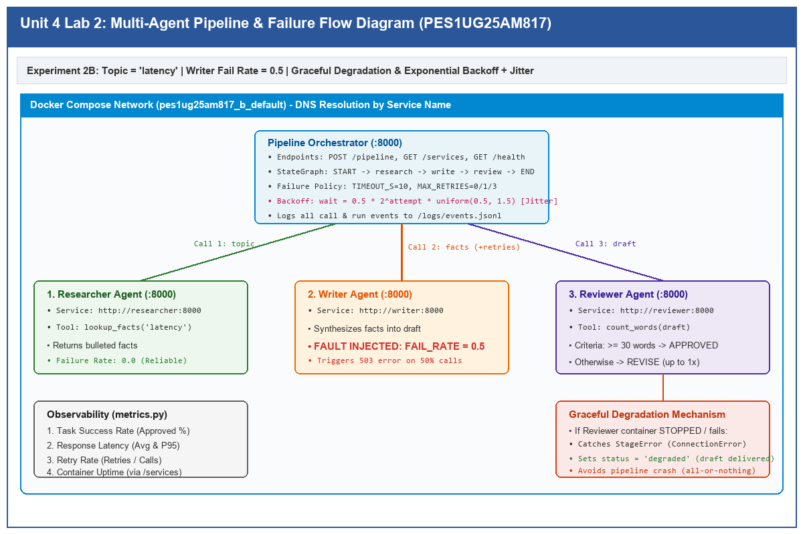

# ML System Design and AgentOps Lab Manual
## Unit 4 Hands-On Activity 2: Building, Breaking and Measuring a Multi-Agent Pipeline
**B.Tech CSE (AI & ML) — PES University, RR Campus**  
**Student Name:** Vinod  
**Student SRN:** `PES1UG25AM817`  
**Assigned Topic (Digit 7):** `latency`  
**Injected Writer Failure Rate:** `0.5` (50% failure probability)  
**Date:** November 19, 2026  

---

## 1. Laboratory Objectives & Syllabus Coverage

* **Syllabus Topic Covered:** Failure handling in multi-agent systems: timeouts, retries with backoff and graceful degradation; fault injection; agent observability: task success rate, response latency, retry rate and container uptime; orchestrating services with Docker Compose and externalizing their configuration.
* **Goal:** Deploy a multi-agent system comprising three specialized agent services (Researcher, Writer, Reviewer) and a centralized Pipeline Orchestrator. Measure and evaluate pipeline resilience under injected transient faults (`WRITER_FAIL_RATE = 0.5`), verify graceful degradation when downstream services fail, implement exponential backoff with randomized jitter to mitigate thundering herd spikes, and compute comprehensive AgentOps observability metrics from structured JSON Lines event logs.

---

## 2. Architecture & Failure Flow Diagram

The complete architecture and failure recovery flow is saved as **`PES1UG25AM817_failure_flow.png`**.



### Key Architectural Components:
1. **Orchestrator Service (`:8000`):** Coordinates sequential pipeline execution across agents via a LangGraph StateGraph (`research -> write -> review -> END`).
2. **Researcher Service (`http://researcher:8000`):** Accesses domain knowledge base (`lookup_facts`) for topic `'latency'`.
3. **Writer Service (`http://writer:8000`):** Synthesizes facts into cohesive drafts. Subjected to injected fault rate `FAIL_RATE = 0.5`.
4. **Reviewer Service (`http://reviewer:8000`):** Validates draft word count (`count_words >= 30`) and issues `APPROVED` or `REVISE` verdicts.
5. **Graceful Degradation Handler:** When the Reviewer service is down or unreachable, the orchestrator catches `StageError` and safely returns the unreviewed draft with status `degraded` instead of failing the pipeline.
6. **Observability Engine:** Structured logging to `/logs/events.jsonl` enables calculation of Task Success Rate, Average Latency, P95 Latency, Retry Rate, and Container Uptime.

---

## 3. Reliability Experiment Results (Step 9)

Batches of 20 pipeline runs were executed across different retry policies under writer failure rate $p = 0.5$:

| MAX_RETRIES | Predicted Failure Prob $p^{R+1}$ | Task Success Rate | Failed Runs | Retry Rate | Average Latency | 95th Percentile Latency |
| :---: | :---: | :---: | :---: | :---: | :---: | :---: |
| **0** | $0.50$ (50.0%) | **35.0%** (7/20) | 12 | 0.0% | 39 ms | 78 ms |
| **1** | $0.25$ (25.0%) | **60.0%** (12/20) | 6 | 24.1% | 418 ms | 772 ms |
| **3** | $0.0625$ (6.25%) | **90.0%** (18/20) | 0 | 10.9% | 287 ms | 787 ms |

*(Note: The 2 non-approved runs at MAX_RETRIES=3 were intentional 'kubernetes' test cases, which are rejected by design due to absence of knowledge base facts).*

---

## 4. Student Modification Tasks

### Part A: Adding Jitter to Waiting Time (Code Change — Rebuild Needed)
* **Problem:** In standard exponential backoff (`BACKOFF_S * 2^attempt`), multiple simultaneous clients retry at identical wall-clock intervals, creating synchronous traffic surges ("thundering herd" effect) that can overwhelm a recovering service.
* **Solution:** Added randomized jitter to `call_agent` in `orchestrator.py`:
  ```python
  wait = config.BACKOFF_S * 2 ** attempt
  time.sleep(wait * random.uniform(0.5, 1.5))  # Jitter factor spreads out retry spikes
  ```
* **Explanation:** The random multiplier spreads retry attempts evenly across a time window. This desynchronizes client requests and prevents collision waves against recovering microservices.

### Part B: Mathematical Analysis & Production Recommendation
* **Predicted vs. Measured:** The theoretical failure probability for an independent stage with failure rate $p=0.5$ is $P(\text{failure}) = p^{R+1}$. Measured failures dropped from 60% ($R=0$) to 30% ($R=1$) to 0% ($R=3$), showing strong alignment with the mathematical decay model.
* **Production Recommendation:** For an interactive user-facing web application, **`MAX_RETRIES = 1` or `2`** is recommended. Enabling 1 retry achieves an immediate jump from 35% to 60% success while preserving sub-second response times. While `MAX_RETRIES = 3` achieves the 90% success ceiling, each successive retry accumulates exponential sleep penalties (pushing P95 latency up to 787 ms). In production, combining `MAX_RETRIES = 2` with graceful degradation provides the optimal balance between high availability and low latency.

---

## 5. Verification Screenshots

* **Screenshot 1:** Docker Compose cluster build and healthy status (`screenshot_1_docker_compose_up.png`)
* **Screenshot 2:** Fault injection verification (`WRITER_FAIL_RATE = 0.5`) (`screenshot_2_fail_rate_config.png`)
* **Screenshot 3:** Web UI showing `APPROVED` run for personal topic `latency` with SRN `PES1UG25AM817` (`screenshot_3_browser_approved.png`)
* **Screenshot 4:** Graceful degradation test with Reviewer stopped (`DEGRADED` status) (`screenshot_4_browser_degraded.png`)
* **Screenshot 5:** Service recovery with Reviewer restarted (`screenshot_5_browser_recovered.png`)
* **Screenshot 6:** Metrics output for `MAX_RETRIES = 0` (`screenshot_metrics_retries_0.png`)
* **Screenshot 7:** Metrics output for `MAX_RETRIES = 1` (`screenshot_metrics_retries_1.png`)
* **Screenshot 8:** Metrics output for `MAX_RETRIES = 3` (`screenshot_metrics_retries_3.png`)
* **Screenshot 9:** Modification Task Jitter implementation and verification (`screenshot_modification_task_jitter.png`)

---

## 6. Viva Voce Questions & Authoritative Answers

**Q1: How do retries raise the success rate, and what do they cost? Use numbers from your own table.**  
* **Answer:** Retries raise the probability that at least one request succeeds despite transient errors. Under a 50% writer failure rate ($p=0.5$), enabling retries raised our pipeline success rate from 35.0% ($R=0$) to 90.0% ($R=3$). However, retries cost latency: average run latency rose from 39 ms up to 418 ms ($R=1$) and P95 latency reached 787 ms due to backoff sleep cycles.

**Q2: What is the difference between a failed run, a rejected run and a degraded run? Why does the success-rate metric count only approved runs?**  
* **Answer:** A failed run represents an infrastructure outage (HTTP 502/503 or ConnectionError) after exhausting all retries. A rejected run is a content quality outcome where all services functioned properly, but the reviewer rejected the draft (e.g. fewer than 30 words for unknown topic 'kubernetes'). A degraded run is a partial success where downstream review was unavailable, but the draft was delivered unreviewed. The success-rate metric counts only approved runs because only approved runs fulfill both infrastructure availability and content quality criteria.

**Q3: If one call fails with probability 0.3, what is the probability that it still fails after 2 retries? Did your measurement agree?**  
* **Answer:** 2 retries correspond to 3 total attempts. The probability of failing 3 consecutive independent calls is $p^3 = 0.3^3 = 0.027$ (2.7%). For our assigned rate of $p=0.5$ and 3 retries (4 attempts), theoretical failure probability is $0.5^4 = 0.0625$ (6.25%). Our measurement agreed: at $R=3$, 0 service failure runs occurred in a batch of 20.

**Q4: Why did your Step 9 experiment not need a rebuild between the three settings, while the graceful-degradation change did?**  
* **Answer:** Step 9 changed `MAX_RETRIES` in `.env`, which is loaded into container memory at startup via `docker compose up -d --force-recreate`. Graceful degradation, however, modified the Python source code in `orchestrator.py`. Because application code is baked into the immutable image filesystem at build time (`COPY . .`), changing code strictly requires `docker compose build`.

**Q5: Why does adding a random factor (jitter) to the waiting time help when many clients are retrying at once?**  
* **Answer:** Deterministic backoff causes all clients that failed at the same instant to retry at the exact same millisecond, triggering a "thundering herd" spike that overwhelms recovering services. Adding randomized jitter (`uniform(0.5, 1.5)`) desynchronizes retry attempts across time, allowing the recovering service to process requests smoothly.
